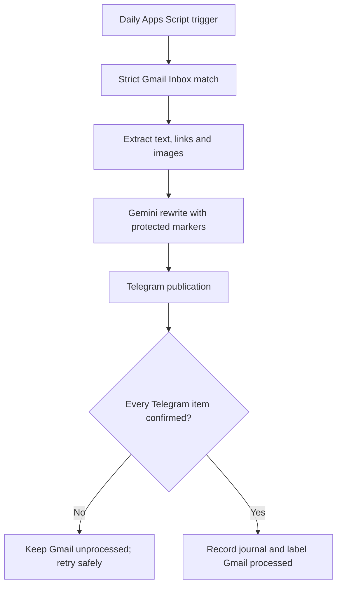

# Full handover

Updated: 28 October 2026

## Can another coding agent continue from GitHub alone?

Yes for development, testing, documentation, and automated deployment. The repository contains the complete application source and the deployment workflow. It is deliberately not a backup of private runtime data or credentials.

| Component | In GitHub? | Where it lives / what Claude needs |
| --- | --- | --- |
| Apps Script backend | Yes | `Code.gs` |
| Private dashboard | Yes | `Index.html` |
| Apps Script manifest and OAuth scopes | Yes | `appsscript.json` |
| Automated tests | Yes | `tests.js` |
| Deployment workflow | Yes | `.github/workflows/deploy-apps-script.yml` |
| Architecture, status and safety rules | Yes | `HANDOVER.md`, `README.md`, `AGENTS.md`, `CLAUDE.md` |
| Gemini API key | No, intentionally | Apps Script Script Properties |
| Telegram bot token and private chat IDs | No, intentionally | Apps Script Script Properties |
| Gmail messages, message IDs and previews | No, intentionally | Gmail and Apps Script private runtime state |
| Apps Script project/deployment IDs and clasp OAuth | Not in source | Encrypted GitHub Actions secrets |
| Live/test mode, trigger state and duplicate journals | No, intentionally | Apps Script properties and triggers |

Claude can therefore clone the repository, read `CLAUDE.md`, change and test the code, and push to `main`. With authorized GitHub access, the existing workflow deploys source changes to the existing Apps Script project. To inspect the authenticated dashboard, Gmail samples, Script Properties, Apps Script execution logs, or Telegram results, Claude also needs access to the owner's signed-in browser or the corresponding authorized service—not copied secrets.

## Outcome and current state

The implementation is a private Google Apps Script web app that runs in Google's cloud. It reads a narrowly identified Espavo newsletter from Gmail, extracts text/images/links, rewrites it with Gemini, and publishes it through the Telegram Bot API only after safety conditions pass.

The deployed Apps Script project already exists and its secrets remain in Script Properties. The repository intentionally contains no secrets and no stored newsletter body.

| Item | Current state |
| --- | --- |
| Apps Script project | Created and authenticated as the owner's Google account |
| Private dashboard | Version 29 deployed automatically to the valid private web-app deployment on 27 October 2026 |
| Gmail account | Connected through Apps Script authorization |
| Newsletter sender | `mailmanager@espavo.org` |
| Historical sample | Configured privately in `TEST_MESSAGE_ID` |
| Telegram bot | `@steve_newsletter_bot` |
| Telegram destination | Test group configured in Script Properties; numeric ID deliberately excluded from this public repository |
| Gemini | API key configured in Script Properties; value excluded from the repository |
| Historical dry run | Version 9 dry run succeeded in 6 seconds with 8 images and 12 useful labelled links |
| Test Telegram publication | Not yet performed for the current rich-message/link build |
| Controlled live publication | Not yet performed |
| Duplicate-prevention live check | Not yet performed |
| Live mode | Off at last verified state |
| Scheduled trigger | Off at last verified state |

Version 29 presents testing as three compact tabs: Find & generate, Preview & compare, and Send test. The original email expands beside the Telegram rendering, optional editing is collapsed, spacing is normalized, and circular cut-outs use uncompressed PNG uploads. Telegram bot setup and automatic-publishing explanations are available as in-page help pop-ups. A dedicated Automatic publishing page shows Gmail, Gemini, bot, production destination, controlled-publication, duplicate-prevention, and cloud-trigger readiness. The trigger cannot be installed until the controlled live send and duplicate-prevention rerun have both succeeded. The configured trigger now runs once daily around 9am London time when enabled.

The original-email pane is a sandboxed rendering of the actual Gmail HTML (`sanitizeOriginalEmailPreview_` in `Code.gs`, displayed in a no-script iframe in `Index.html`). It preserves the newsletter's 640 px card layout, inline colours, spacing, headings, images and styled CTA buttons while removing scripts, forms, frames, inline event handlers, meta refresh, tracking pixels and active navigation. Meaningfully labelled MailerLite CTA redirects may be retained as protected links (maximum 12), while raw tracking URLs remain hidden from the post body. Regression coverage for these removals is in `tests.js`.

## Application version

`APP_VERSION` in `Code.gs` is the application version (semantic `MAJOR.MINOR.PATCH`). It is shown beside the dashboard title and checked by `tests.js`. Increase it with every change: patch for fixes and small edits, minor for new features, major for breaking changes. The current version is **1.0.10**. Apps Script's own deployment number (for example Version 29) is separate.

## Resources

- GitHub: <https://github.com/granterogers/steve-rother-email2telegram>
- The Apps Script project ID, editor URL, private web-app URL, Gmail account, Gmail message IDs, Telegram destination ID, and credentials are deliberately retained only in the owner's private Google configuration.

The valid owner-only web-app deployment serves Apps Script Version 29. GitHub Actions pushes source, creates a version, and updates this deployment automatically when Apps Script source changes on `main`. The manifest explicitly retains the private web-app entry point. A separate historical deployment without a web-app entry point was mistakenly updated to Version 19 and must not be used as the production deployment target.

## Architecture



1. A once-daily Apps Script trigger calls `scheduledRun` around 9am London time when enabled.
2. Gmail candidates come from a narrow sender query.
3. `isNewsletter_` requires the exact sender plus at least four independent bulk-newsletter signals (MailerLite headers, DKIM evidence, unsubscribe header, bulk precedence, multipart MIME, etc.).
4. The extractor removes boilerplate and trackers while retaining meaningful images and editorial links in source order.
5. Images and links become protected markers before the cleaned text is sent to Gemini.
6. Gemini rewrites within a bounded prompt/output budget.
7. Deterministic post-processing restores any missing marker and removes duplicate marker occurrences.
8. Telegram `sendRichMessage` is attempted first, producing interleaved paragraphs, images, and clickable links in one rich message.
9. If rich messages are rejected, the publisher falls back to ordered text/photo messages; link markers expand to labelled full URLs.
10. A per-Gmail-message journal stores every confirmed Telegram message ID and next position so retries resume safely.
11. Only after Telegram success is recorded does the workflow store `PROCESSED_<gmailMessageId>` and apply the Gmail label `Espavo/Telegram-Processed`.

## Safety model

- `LIVE_MODE=false` blocks scheduled publication.
- Dry-run TEST MODE calls Gemini but neither Telegram nor Gmail mutation.
- Dashboard test publication requires an explicit confirmation phrase and never marks Gmail processed.
- The first production publication requires `LIVE_APPROVED_MESSAGE_ID` to exactly match the approved Gmail item.
- A script lock prevents overlapping executions.
- Retry/backoff is bounded.
- Processing is idempotent through both the publication journal and processed record.
- Secrets are read only from Apps Script Script Properties.
- Logs avoid tokens and raw API responses. Dry-run output is intentionally visible for editorial review.

## Script Properties

Manage these under **Apps Script → Project Settings → Script properties** or through the private dashboard where supported.

| Property | Required value/state |
| --- | --- |
| `GEMINI_API_KEY` | Existing Gemini key; never commit it |
| `TELEGRAM_BOT_TOKEN` | Existing BotFather token; never commit it |
| `TELEGRAM_CHAT_ID` | Numeric test group/channel ID; never commit it in this public repository |
| `TEST_TELEGRAM_CHAT_ID` | Optional test-only group/channel ID; changing it does not alter production |
| `TELEGRAM_THREAD_ID` | Optional forum topic ID inside the production group. Set it in **Connections → Production topic**: press **Find topics in group** and choose from the list, or paste a message link from the topic (`t.me/group/TOPIC/MESSAGE`). The list comes from recent bot updates, so the bot must be an admin and each topic needs one message first. Blank or `1` (General) posts to the group itself. Production posts only; never used for test destinations |
| `TEST_MESSAGE_ID` | The privately selected historical Gmail message ID |
| `LIVE_MODE` | Keep `false` until the controlled publication is approved |
| `LIVE_APPROVED_MESSAGE_ID` | Blank except during the one-item controlled release |
| `UI_CONFIG` | Dashboard-managed parsing and formatting settings |
| `LAST_TEST_RESULT` | Latest stored dry-run preview; contains newsletter-derived content and remains private |

## Exact continuation sequence

1. Ensure the Apps Script editor contains the repository versions of `Code.gs` and `Index.html`, and the manifest matches `appsscript.json`.
2. Create a new web-app deployment/version, keeping **Execute as: Me** and **Who has access: Only myself**.
3. Open the private dashboard and run **Validate connections**.
4. Click **Scan my inbox**, choose one or more verified newsletters, and click **Generate selected previews**. Only active Inbox messages are scanned; archived, Spam, and Trash messages are excluded. This sends only the selected newsletter content to the configured Gemini API; it does not contact Telegram or modify Gmail.
5. Confirm every preview displays real images, clickable event/source links, and no unresolved `[[IMAGE_n]]` or `[[LINK_n]]` placeholders.
6. Choose the **Telegram test destination** using discovery or a known group/channel ID. This setting is separate from production.
7. Send previews individually or use **Send all generated previews**. Confirm the messages in Telegram and verify Gmail remains unlabelled.
8. If approved for production, call `approveExactlyOneMessageForLivePublication('<approved Gmail message ID>')` using the private ID shown in the dashboard.
9. Run `runApprovedMessageOnce`. Confirm Telegram success, then confirm the Gmail processed label appears.
10. Run `runApprovedMessageOnce` again and verify the result is `duplicate_prevented` with no second Telegram publication.
11. Only after all checks pass, run `installHourlyTrigger`. The legacy function name now installs the once-daily schedule.

Steps 2, 4, 7, 8, 9, and 11 are deliberate authorization/publication gates and should not be automated past without the owner's explicit approval at the time.

## Dashboard behavior

- **Parsing & writing** edits sender/query boundaries, cleanup patterns, prompt, model, length, and image count.
- **Connections** stores keys in Script Properties, discovers Telegram groups, and validates Gmail/Gemini/Telegram configuration.
- **Test preview** scans only the active Inbox using production-grade identification, supports selecting up to ten newsletters, and renders each final Telegram rich message—not placeholder tokens—including direct clickable hyperlinks and images distributed through the post.
- Each preview carries a server-generated signature; edited or stale payloads are refused by the test-send endpoint.
- A separate customizable test destination can be selected from groups/channels visible to the bot without changing the production destination. The dashboard shows its readable Telegram title/type as well as the underlying ID.
- Individual and send-all test actions require in-page confirmation and never mark Gmail processed.

## Deployment notes

The GitHub repository is the canonical source. `.github/workflows/deploy-apps-script.yml` deploys source changes on `main` through authenticated `clasp`. The project ID, existing deployment ID, and clasp credential are stored as encrypted GitHub Actions secrets; `.clasp.json` and OAuth credentials are never committed.

When deploying manually:

1. Open **Deploy → Manage deployments**.
2. Edit the web-app deployment.
3. Select **New version**.
4. Keep owner-only access and execute-as-owner unchanged.
5. Deploy and verify the existing `/exec` URL.

## Operations and troubleshooting

- Dashboard status cards show whether Gemini, Telegram, destination, live mode, and cloud schedule are ready.
- Apps Script **Executions** is the primary log location.
- `validateConfiguration()` checks current bot, destination, model, trigger, and safety state.
- If Telegram cannot fetch an external image URL, rich publication falls back only for recognized compatibility errors; other failures stop processing and leave Gmail unprocessed.
- If a Telegram sequence partially succeeds, rerun the same item. The journal resumes after the last confirmed message.
- If Gemini returns no content or reaches the output cap, nothing is published.
- If a newsletter fails strict identification, it is ignored or receives the error path rather than being broadly published.
- To stop all unattended activity, run `disableAutomation()`.

## Editing guide

- Rewrite style: dashboard **Rewrite instructions** or `CONFIG.rewritePrompt`.
- Parsing boundaries/removal patterns: dashboard **Parsing & writing**.
- Model: dashboard **Gemini model** or `CONFIG.model`.
- Formatting: `rewriteWithGemini_`, `buildTelegramRichHtml_`, and `Index.html` preview renderer.
- Link behavior: `htmlToImageAwareText_`, `ensureLinkMarkers_`, `richTextWithLinks_`, and `expandLinkMarkers_`.
- Image behavior: `newsletterImageFromTag_`, `ensureImageMarkers_`, and Telegram rich/fallback builders. Circular images are cut by weserv to an 800 px opaque JPEG on white (`mask=circle&mbg=ffffff&output=jpg`, from `circularTransparentImageUrl_`). `mbg` is the parameter that fills the masked corners; `bg` does not apply to JPEG output and leaves corners black. Circles then go through the same rich post as every other image, so they stay inline and in source order. A bold line on its own (a heading) is its own paragraph. Link previews are disabled on text messages (`disable_web_page_preview`). The 1.0.2 PNG-document route has been removed.

To see what the publisher will send, run `node tools/telegram-preview/render.js`. It writes `email.png`, `telegram-rich.png` and `telegram-ordered.png` to `tools/telegram-preview/out/`. The renderer uses the real builders from `Code.gs` and placeholder artwork, so it shows layout and content order, not Telegram's exact styling. Only a real test send shows the true Telegram rendering.
- Schedule: once daily around 9am London time, configured in `installHourlyTrigger`; reinstall the trigger after changing it.

## Verification already completed

Local checks completed successfully on 28 October 2026 (includes the publishing fidelity regression tests) (Node 22, working tree at `e45e226` plus the sanitizer regression test):

```text
node --check < Code.gs
node tests.js
All local helper tests passed.
```

Those tests cover boilerplate cleanup, labelled redirect preservation, useful-link metadata, image filtering and order, protected markers, rich Telegram HTML, ordered fallback, message chunking, trimming, tracking-URL classification, and digest stability.

## Known remaining work

- Regenerate a preview in Version 29 and use the Automatic publishing page to perform the controlled production send, duplicate-prevention check, and trigger installation when the final output and production destination are approved.
- The faithful original-email rendering and editable rich Telegram preview were visually verified side by side for that sample.
- Choose a test-only Telegram destination and inspect both individual and send-all rendering.
- Perform the one-item controlled production test only after editorial approval.
- Verify duplicate prevention with a second run.
- Install the once-daily trigger only after the controlled publication passes.

Until those items are complete, the system should remain in TEST MODE with no production trigger.
